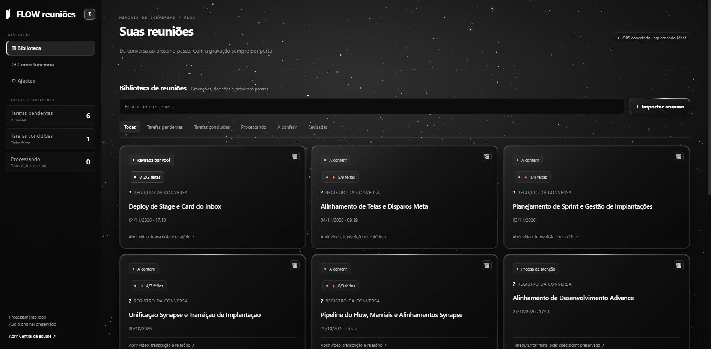
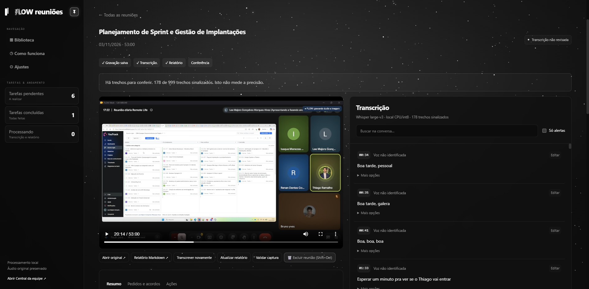
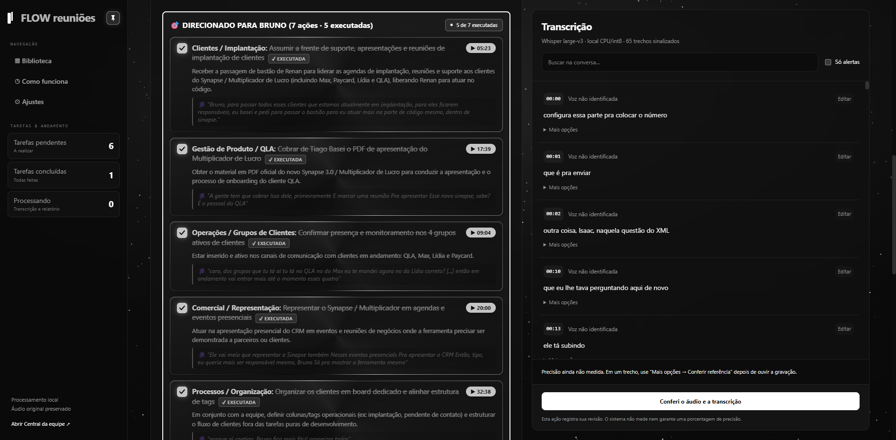
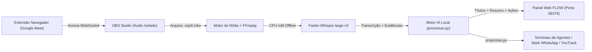

# FLOW Reuniões — Inteligência Operacional Autônoma 100% Local


-38bdf8?style=for-the-badge)


**FLOW Reuniões** é uma plataforma autônoma de gravação, transcrição local, síntese inteligente e extração cirúrgica de tarefas a partir de chamadas no **Google Meet**, projetada para rodar **100% na máquina local** (zero nuvem de terceiros) e despachar ações diretamente para terminais de agentes autônomos, **YouTrack** e **WhatsApp**.

---

## Visão Geral da Interface

### 1. Biblioteca Inteligente com Títulos Automáticos & Filtro de Pendências


### 2. Player de Vídeo Sincronizado + Transcrição Faster-Whisper (`large-v3`)


### 3. Extração Cirúrgica: *"Direcionado para Você"* com Citações Literais e Checklist


---

## Arquitetura do Sistema



---

## Principais Funcionalidades

- **Captura Automática Google Meet + OBS (`meet_capture.py`):** Detecta automaticamente quando você entra em uma reunião do Google Meet e inicia a gravação no OBS Studio com isolamento de faixa de áudio (evitando duplicação de voz ao navegar no vídeo).
- **Transcrição Offline de Alta Precisão (`qualidade.py`, `precisao.py`):** Roda `Faster-Whisper large-v3` localmente na CPU (`int8`), sinalizando trechos de baixa confiança para conferência rápida.
- **Batismo Automático de Títulos (`processar.py`, `core.py`):** A IA analisa o resumo real da conversa e batiza a reunião automaticamente pelo assunto da pauta, ordenando da mais recente para a mais antiga.
- **Gestão de Pendências por Abas (`app.js`, `painel.html`):** Separa instantaneamente reuniões **Com tarefas pendentes** (ex.: `4/7 feitas`) das reuniões **Concluídas** (`7/7 feitas`).
- **Seção *"Direcionado para Você"*:** Extrai tudo o que foi pedido diretamente ao usuário, exibindo a **Área/Cliente**, o **Contexto Completo**, a **Citação Literal + Timestamp** e um checkbox interativo (`EXECUTADA`).
- **Exclusão Total (`Shift+Del`):** Remove o registro do banco SQLite, apaga os artefatos de análise e exclui o arquivo de vídeo bruto do disco em um único clique.

---

## Estrutura de Módulos

| Arquivo | Responsabilidade |
| :--- | :--- |
| `servico.py` | Servidor HTTP local (`127.0.0.1:58376`) e API REST para biblioteca, mídia, checklists e exclusão total. |
| `core.py` | Orquestração de estado, fila de jobs, geração de títulos descritivos e sincronização com SQLite. |
| `processar.py` | Pipeline de análise semântica, síntese executiva e extração de tarefas direcionadas com UTF-8 estrito. |
| `propostas.py` | Geração de propostas acionáveis (`propostas_pendentes.json`) para integração com agentes e WhatsApp. |
| `meet_capture.py` | Integração direta com OBS WebSocket e extensão do navegador para gravação sem intervenção manual. |
| `painel.html` / `app.js` | Interface web reativa em dark mode com barra lateral auto-retrátil, player sincronizado e gestão de ações. |

---

## Como Executar Localmente

1. Copie `config.example.json` para `config.json` e ajuste os caminhos locais do OBS e do modelo Whisper.
2. Inicie o serviço:
   ```bash
   python -X utf8 servico.py --runtime .
   ```
3. Acesse `http://127.0.0.1:58376/` no navegador.
